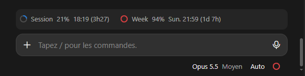
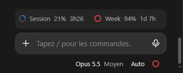
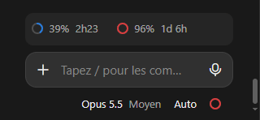
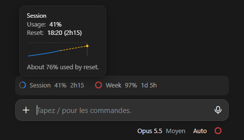
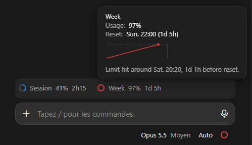

# Claude Desktop Mods

Quality of life mods for the Claude Desktop app (Code).

## Mods

### [usage-glance](plugins/usage-glance)

> Your session and weekly usage as two quiet rings above the chat input.

A single, dimmed line that stays out of the way: a ring per limit, its usage and when it resets, colored like the app's own usage ring. It adapts to the width available, dropping detail as room runs out, and hovering a limit shows its full usage and reset in a popover. Nothing to open or click.

<p>
  
  
  
</p>

<p>
  
  
</p>

<br>

## Install

In a terminal, add the `yo-l-an/claude-desktop-mods` repository as a marketplace, then install the mod.

```bash
claude plugin marketplace add yo-l-an/claude-desktop-mods
claude plugin install usage-glance@claude-desktop-mods
```

To update after a new version is pushed:

```bash
claude plugin marketplace update claude-desktop-mods
claude plugin update usage-glance@claude-desktop-mods
```

## Development

On the development machine, install from the working copy too. The app then reads the plugin from this folder. `.claude-plugin/marketplace.dev.json` lists the same mods as `claude-desktop-mods-dev`, so it sits beside the GitHub marketplace instead of replacing it:

```bash
npm install
claude plugin marketplace add <path to this repository>/.claude-plugin/marketplace.dev.json
claude plugin install usage-glance@claude-desktop-mods-dev
```

Keep one of the two copies of a mod enabled at a time, or both draw. Switch with `claude plugin disable usage-glance@claude-desktop-mods` and `claude plugin enable usage-glance@claude-desktop-mods-dev`, then `/reload-plugins`.

Each change:

1. Edit `plugins/<mod>/`.
2. `npm run check` validates the manifest and hooks, type-checks, and runs the tests.
3. Run `/reload-plugins` in a Code session (or open a new one) and check the change in the app.
4. Raise `version` in the mod's `plugin.json`, then commit and push. Other machines only pick up a new version.

The `claude` CLI in `devDependencies` is pinned to the engine version of Claude Desktop. Keep the two the same, because older engines refuse newer props.
